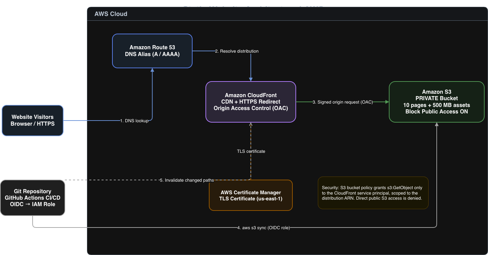
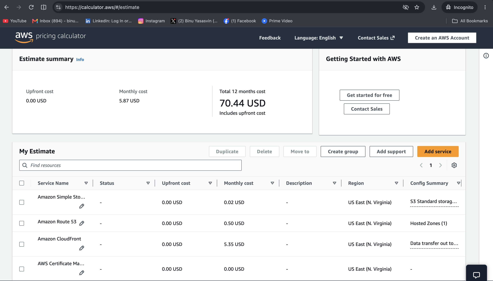

### Scenario 1: Static Website Hosting

**Recommended solution:** Amazon S3, Amazon CloudFront, AWS Certificate Manager (ACM), and Amazon Route 53.

#### Architecture Diagram

I would store the static website's HTML, CSS, JavaScript, and 500 MB of assets in an Amazon S3 bucket and distribute the content through CloudFront. Route 53 would point the existing domain to the CloudFront distribution, while ACM would provide a TLS certificate for HTTPS. CloudFront would redirect HTTP requests to HTTPS and cache content at edge locations.

**Security:** The S3 bucket would have Block Public Access enabled. I would use CloudFront Origin Access Control (OAC) with a bucket policy allowing read-only access exclusively from the designated CloudFront distribution. This prevents visitors from bypassing CloudFront and accessing the content directly through public S3 URLs. I would use the S3 REST endpoint rather than the S3 website endpoint.

**Deployment:** I would maintain the website source in Git and deploy changes using GitHub Actions. The pipeline would validate the site, authenticate to AWS through OIDC, synchronize the generated files to S3, and invalidate changed CloudFront paths where necessary. Versioned asset filenames would improve cache efficiency.

**Cost and operational considerations:** This serverless architecture requires no EC2 instances, operating system patching, or web server administration. Costs are primarily based on S3 storage and requests, CloudFront usage, and Route 53 DNS. It provides high availability and scales automatically with traffic.

**Assumption:** The website contains only static content and does not require server-side application processing.

#### AWS Pricing Calculator Estimate

I used the AWS Pricing Calculator to estimate the
operational cost of hosting the static website.

| AWS Service | Monthly Cost |
|---|---:|
| Amazon S3 | $0.02 |
| Amazon Route 53 | $0.50 |
| Amazon CloudFront | $5.35 |
| AWS Certificate Manager | $0.00 |
| **Total Monthly Cost** | **$5.87** |

- **Upfront cost:** $0.00
- **Estimated annual cost:** $70.44
- **Pricing region:** US East (N. Virginia)
- **Pricing source:** AWS Pricing Calculator
- **Estimate date:** November 2026

The estimate includes S3 storage, CloudFront content
delivery, and one Route 53 hosted zone.

A standard non-exportable ACM public certificate is used
for HTTPS without additional certificate charges.

The estimated monthly infrastructure cost is $5.87
under the configured usage assumptions. Actual costs
may vary based on traffic, request volume, and
applicable pricing allowances.

#### Cost Optimization

- CloudFront caching reduces repeated S3 requests.
- No EC2 instances or continuously running servers are required.
- Versioned assets reduce unnecessary cache invalidations.
- AWS-managed services minimize maintenance overhead.

#### AWS References

- [AWS Pricing Calculator](https://calculator.aws/#/estimate)
- [Amazon S3 Pricing](https://aws.amazon.com/s3/pricing/)
- [Amazon CloudFront Pricing](https://aws.amazon.com/cloudfront/pricing/)
- [Amazon Route 53 Pricing](https://aws.amazon.com/route53/pricing/)
- [AWS Certificate Manager Pricing](https://aws.amazon.com/certificate-manager/pricing/)
- [CloudFront Origin Access Control](https://docs.aws.amazon.com/AmazonCloudFront/latest/DeveloperGuide/private-content-restricting-access-to-s3.html)
