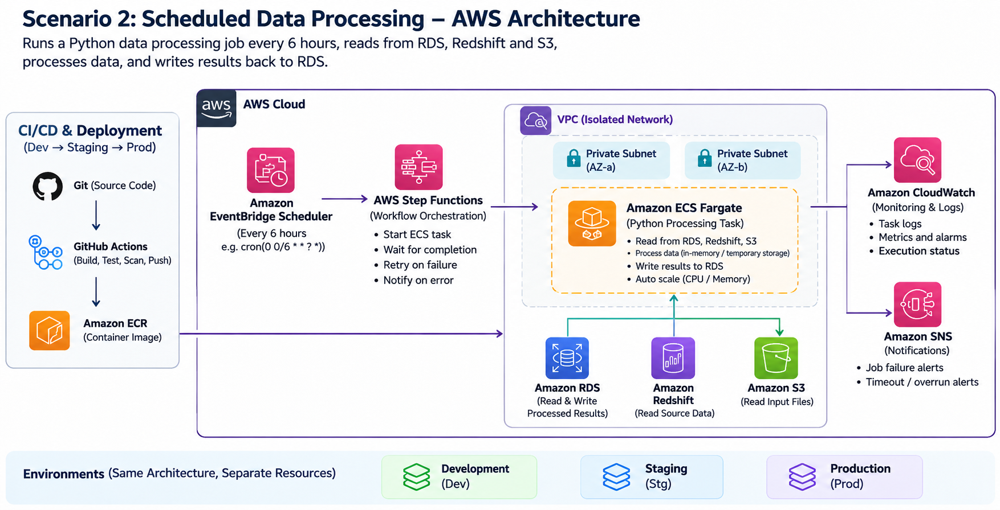

### Scenario 2: Scheduled Data Processing

**Recommended solution:** Amazon ECS Fargate, Amazon EventBridge Scheduler, AWS Step Functions, Amazon ECR, and Amazon CloudWatch.

#### Requirements

The Python application must:

- Read data from Amazon RDS, Amazon Redshift, and Amazon S3.
- Process data in memory or temporary disk storage.
- Write the processed results back to Amazon RDS.
- Execute automatically every 6 hours.
- Complete each execution in approximately 45–60 minutes.
- Scale as data volume increases.
- Run without persistent application storage.
- Support dev, staging, and production environments.
- Allow updates with minimal disruption.

#### Architecture Diagram

The processing workflow follows this sequence:

1. EventBridge Scheduler triggers the workflow every 6 hours.
2. Step Functions coordinates the processing task.
3. ECS Fargate starts a container running the Python application.
4. The application reads from RDS, Redshift, and S3.
5. Data is processed in memory or Fargate temporary storage.
6. Processed results are written to RDS.
7. The container exits when processing completes.
8. CloudWatch collects logs and metrics, while failures trigger alerts.

#### Compute and Scheduling Approach

**Amazon ECS Fargate**

I would containerize the Python application and run it as an ECS Fargate task.

Fargate is suitable because it provides serverless container execution without requiring EC2 instance management.

Each scheduled execution starts a task, processes the data, writes the results, and exits.

The application would remain stateless, using container memory and Fargate ephemeral storage for temporary processing.

Fargate provides 20 GiB of ephemeral storage by default, which can be increased when larger temporary datasets are required, subject to service limits.

CPU, memory, and ephemeral storage would be configured according to the processing requirements.

**Amazon EventBridge Scheduler**

I would configure EventBridge Scheduler to trigger the workflow every six hours.

Example schedule:

`cron(0 0/6 * * ? *)`

Timezone: UTC

This runs at 00:00, 06:00, 12:00, and 18:00 UTC.

Flexible time windows would be disabled to maintain predictable execution times.

**AWS Step Functions**

I would use a Standard Step Functions workflow to coordinate the ECS task.

The workflow would use the ECS `RunTask` integration with the `.sync` pattern to wait for the task to complete.

It would inspect the ECS task result, including container exit codes, before treating the processing job as successful.

Step Functions would also manage execution timeouts, error handling, and notifications.

#### Data Processing Flow

1. EventBridge Scheduler starts a Step Functions execution.
2. The workflow checks whether another processing run is active.
3. If a previous run is still active, the new run is skipped or delayed according to the configured policy.
4. Step Functions starts an ECS Fargate task.
5. The Python application connects to RDS, Redshift, and S3.
6. The application reads and processes the required datasets.
7. Temporary files are stored in Fargate ephemeral storage when necessary.
8. Processed results are written to RDS.
9. The application exits with an appropriate exit code.
10. Step Functions records the outcome, and CloudWatch provides logs and monitoring.

#### Scaling Strategy

The application must scale as data volume increases.

I would initially use vertical scaling by increasing the Fargate task's CPU, memory, and ephemeral storage allocations.

For larger datasets, I would divide processing into smaller independent partitions, such as date ranges or batches.

These partitions could be processed by multiple Fargate tasks coordinated through Step Functions Distributed Map, where appropriate.

Parallel processing would be introduced only when the workload supports independent partitions and the source and destination databases can handle the additional connections and throughput.

The RDS database would remain the shared destination for processed results.

This approach provides scalable processing without maintaining permanent application servers.

#### Development, Staging, and Production

I would maintain separate configurations for development, staging, and production.

Each environment would have:

- Its own EventBridge schedule and Step Functions workflow.
- Its own ECS task definition and configuration.
- Environment-specific database connections.
- Separate IAM roles and access permissions.
- Separate CloudWatch logs and monitoring.
- Secrets stored in AWS Secrets Manager or SSM Parameter Store.

Infrastructure would be defined using Terraform and reusable modules.

The Python application would be packaged as a Docker image and stored in Amazon ECR.

A CI/CD pipeline would build and test the application, scan the container image, and deploy the same immutable image version across environments.

Deployment sequence:

Development → Staging → Production

Updating an ECS task definition would not interrupt an already running scheduled task.

New executions would use the newly deployed task definition, while existing tasks could complete using their original version.

For this batch-processing workload, a rolling ECS service deployment is unnecessary because tasks are launched on demand.

#### Failure Handling

I would implement the following failure-handling mechanisms:

**1. Application failures**

The Python application would return a non-zero exit code when processing fails.

Step Functions would detect the failed ECS task and mark the workflow as failed.

**2. Retries**

Step Functions would retry transient failures using exponential backoff and a limited retry count.

Retries would be applied only where safe.

The application would use idempotent processing and database writes to prevent duplicate results.

**3. Monitoring and alerting**

CloudWatch Logs would capture application output and error messages.

CloudWatch alarms and EventBridge notifications could trigger Amazon SNS alerts for failed workflows.

**4. Database consistency**

Processed results would be written using database transactions, staging tables, or idempotent upsert operations where appropriate.

This would reduce the risk of partial writes or duplicated data when a task fails or is retried.

#### Handling Overrunning or Overlapping Jobs

Although each execution normally takes 45–60 minutes, unexpected delays could cause a run to exceed its expected duration.

I would configure a maximum execution duration based on the business requirements.

For example, a two-hour timeout could be used initially, with alerts raised when execution exceeds the expected one-hour duration.

Because Step Functions allows multiple executions of the same state machine, it does not automatically prevent overlapping runs.

I would implement a concurrency guard using a DynamoDB lock item acquired with a conditional write.

The lock would contain an execution identifier and expiration timestamp.

If the lock is already held, the next execution would be skipped or delayed according to business requirements.

The workflow would release the lock after completion or failure. Expired locks would be handled safely to avoid permanently blocking processing.

For timed-out tasks, the workflow would ensure that the ECS task has stopped before allowing another run to write to the destination database.

This prevents simultaneous executions from creating inconsistent results.

#### Why Not Other AWS Services?

| Alternative | Reason Not Selected |
|---|---|
| AWS Lambda | The application runs for 45–60 minutes, exceeding Lambda's maximum execution duration of 15 minutes. |
| Amazon EC2 | Requires instance management, operating system patching, and capacity planning. Unnecessary for a job running four times daily. |
| AWS Glue | Suitable for managed ETL and large-scale distributed data processing, but potentially more complex than required for an existing container-compatible Python application. |
| AWS Batch | Strong option for large-scale batch processing and job queues, but adds orchestration complexity that is not initially necessary for a single scheduled workload. |
| Amazon EKS | Provides container orchestration and scaling, but introduces additional Kubernetes management complexity for this requirement. |

#### Cost and Operational Considerations

ECS Fargate charges for the CPU, memory, and additional ephemeral storage provisioned while tasks run.

The application runs four times daily, approximately 120 executions per 30-day month.

At 45–60 minutes per execution, this represents approximately 90–120 hours of task execution per month.

Unlike a continuously running EC2 instance, Fargate does not require compute capacity to remain active between scheduled executions.

Additional costs may include:

- Step Functions state transitions.
- EventBridge Scheduler invocations.
- CloudWatch Logs and monitoring.
- Amazon ECR image storage.
- Network connectivity, including NAT gateways or VPC endpoints.
- Data transfer and database usage.

I would place Fargate tasks in private subnets and allow access to RDS and Redshift through security groups.

S3 access would use a gateway VPC endpoint where appropriate.

Other required AWS service access would use VPC endpoints or NAT connectivity, depending on cost and operational requirements.

#### Security

- Run Fargate tasks in private subnets without public IP addresses.
- Use least-privilege ECS task roles for AWS resource access.
- Use an ECS task execution role for image pulls and logging.
- Store database credentials in Secrets Manager.
- Use IAM authentication for supported database connections where appropriate.
- Restrict database connectivity using security groups.
- Encrypt data in transit and at rest.
- Avoid storing credentials in Docker images or application source code.

#### Assumptions

- The Python application can run inside a Docker container.
- Each processing run is independent and can be retried safely.
- RDS and Redshift are reachable from the selected VPC.
- The application can process its workload within supported Fargate CPU, memory, and ephemeral storage limits.
- Data partitioning can be introduced if processing requirements increase.
- Overlapping executions are not permitted by default.

#### Conclusion

I would choose ECS Fargate with EventBridge Scheduler and Step Functions because it provides a scalable, serverless batch-processing architecture with minimal infrastructure management.

The application runs only when scheduled, uses temporary processing resources, and supports controlled deployments across development, staging, and production.

Step Functions provides execution monitoring, retry handling, and workflow coordination, while CloudWatch provides centralized logging and alerting.

This design balances cost efficiency, operational simplicity, scalability, and reliability.

#### AWS References

- [Amazon ECS Fargate](https://aws.amazon.com/fargate/)
- [AWS Fargate Pricing](https://aws.amazon.com/fargate/pricing/)
- [Amazon EventBridge Scheduler](https://docs.aws.amazon.com/scheduler/latest/UserGuide/what-is-scheduler.html)
- [AWS Step Functions](https://docs.aws.amazon.com/step-functions/latest/dg/welcome.html)
- [Step Functions ECS Integration](https://docs.aws.amazon.com/step-functions/latest/dg/connect-ecs.html)
- [Fargate Ephemeral Storage](https://docs.aws.amazon.com/AmazonECS/latest/developerguide/fargate-task-storage.html)
- [Amazon ECS Task IAM Roles](https://docs.aws.amazon.com/AmazonECS/latest/developerguide/task-iam-roles.html)
- [Amazon CloudWatch](https://aws.amazon.com/cloudwatch/)
- [AWS Secrets Manager](https://aws.amazon.com/secrets-manager/)
