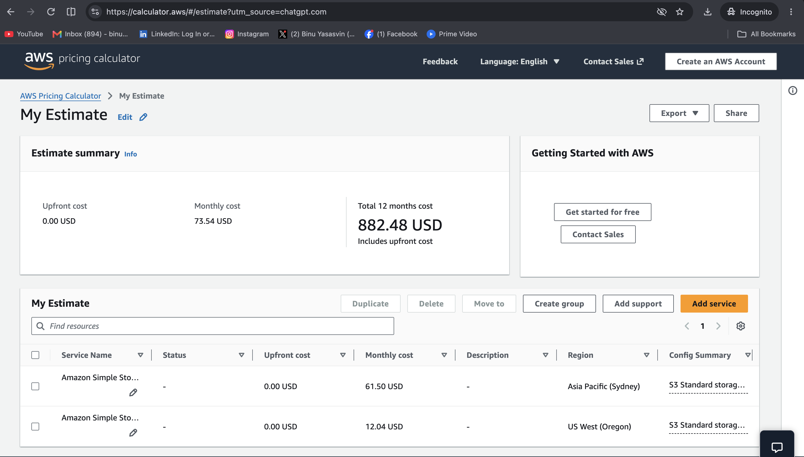

# Scenario 3: Cross-Region S3 Data Transfer

## 1. Requirements

Migrate 500 GB of data from two Amazon S3 buckets in Sydney (`ap-southeast-2`) to two new S3 buckets in Oregon (`us-west-2`).

The solution must:
- Minimize migration cost.
- Preserve the required data.
- Verify migration completeness.
- Provide a pricing breakdown and AWS references.

## 2. Recommended Solution

**AWS CLI `s3 sync` for a one-time, direct S3-to-S3 migration.**

I selected this approach because it uses native S3 copy operations without requiring additional EC2 instances, local storage for the dataset, or a continuously running replication service.

The original buckets will remain intact until migration verification and cutover are complete.

### Assumptions

- The migration is performed once.
- Both source buckets use S3 Standard.
- Destination buckets use S3 Standard.
- Total data across both buckets is 500 GB.
- The object count is unknown; 100,000 objects is used as a pricing assumption.
- The source dataset can be frozen during final synchronization.
- Objects are not archived in Glacier.
- Additional KMS, retrieval, and special request charges are excluded unless applicable.
- All amounts are in USD.

## 3. Architecture

```text
       AWS Region: Sydney (ap-southeast-2)

       +-----------------------------+
       | S3 Source Bucket A          |
       +-----------------------------+
                     |
                     | Direct S3-to-S3 copy
                     |
       +-----------------------------+
       | S3 Source Bucket B          |
       +-----------------------------+
                     |
                     v
             AWS CLI s3 sync
             IAM-authorized
             Cross-region copy
                     |
                     v

       AWS Region: Oregon (us-west-2)

       +-----------------------------+
       | S3 Destination Bucket A     |
       +-----------------------------+

       +-----------------------------+
       | S3 Destination Bucket B     |
       +-----------------------------+

       Validation:
       Object keys + counts + sizes + checksums
```

The migration maps source bucket A to destination bucket A and source bucket B to destination bucket B.

## 4. Implementation

### Step 1: Create Destination Buckets

Create two S3 buckets in `us-west-2`.

Configure:
- S3 Block Public Access.
- Appropriate bucket policies.
- Default server-side encryption.
- Versioning if required.
- IAM access restricted to the migration identity and authorized applications.

### Step 2: Configure IAM Permissions

The migration identity needs:

- `s3:ListBucket` on source and destination buckets.
- `s3:GetObject` on source objects.
- `s3:PutObject` on destination objects.

Additional permissions may be necessary for object tags, metadata, versioning, or SSE-KMS encryption.

Use an IAM role with temporary credentials where possible.

### Step 3: Perform an Initial Dry Run

```bash
aws s3 sync \
  s3://source-bucket-a \
  s3://destination-bucket-a \
  --source-region ap-southeast-2 \
  --region us-west-2 \
  --dryrun
```

Repeat for bucket B.

The dry run previews the proposed copy operations without performing them.

### Step 4: Copy the Data

```bash
aws s3 sync \
  s3://source-bucket-a \
  s3://destination-bucket-a \
  --source-region ap-southeast-2 \
  --region us-west-2
```

```bash
aws s3 sync \
  s3://source-bucket-b \
  s3://destination-bucket-b \
  --source-region ap-southeast-2 \
  --region us-west-2
```

These commands copy objects directly between S3 buckets.

AWS CLI `sync` supports S3-to-S3 copying and can be rerun after interruption.

### Step 5: Final Synchronization

After stopping writes to the source buckets, rerun both synchronization commands.

This copies remaining changes before cutover.

Avoid `--delete` during migration because it can remove destination objects.

**Important:** Standard `sync` does not preserve historical object versions or delete markers. If those are required, a version-aware migration method is necessary.

## 5. AWS Pricing Calculator Estimate

### Pricing Evidence

I configured the AWS Pricing Calculator for:

**Source**
- Service: Amazon S3.
- Region: Asia Pacific (Sydney).
- Outbound data transfer: 500 GB.
- Destination: US West (Oregon).

**Destination**
- Service: Amazon S3.
- Region: US West (Oregon).
- Storage class: S3 Standard.
- Destination storage: 500 GB.
- COPY/PUT requests included according to the estimate configuration.

Calculator reference:

https://calculator.aws/#/estimate

### Calculator Results

The AWS Pricing Calculator screenshot produced:

| Component | Region | Monthly Estimate |
|---|---|---:|
| Source S3 configuration | Sydney | $61.50 |
| Destination S3 configuration | Oregon | $12.04 |
| **Total** | | **$73.54** |

**Upfront cost:** $0.00

**Calculator 12-month projection:** $882.48



### Cost Interpretation

The calculator displays $73.54 as a monthly estimate.

However, this is a one-time migration.

The cross-region copy should be charged only when the data is transferred. Destination storage continues to incur charges while the objects remain in Oregon.

The $882.48 projection assumes that the configured monthly usage repeats for 12 months. It should not be interpreted as the actual annual cost of a single migration.

The $61.50 Sydney subtotal must be checked against the calculator's expanded line items before treating it entirely as a data-transfer charge. The screenshot confirms the subtotal but does not show its detailed components.

### Cost Breakdown

The principal cost categories are:

| Cost Category | Description |
|---|---|
| Cross-region transfer | Data transferred out of Sydney to Oregon |
| Destination COPY/PUT requests | Requests needed to create destination objects |
| Destination storage | Recurring storage for 500 GB in Oregon |
| LIST and verification requests | Requests used for synchronization and validation |
| Additional charges | KMS, object retrieval, or other applicable charges |

The calculator's $73.54 estimate is the documented scenario total under its entered assumptions, not a guaranteed final AWS bill.

Actual charges depend on the transfer rate, object count, request volume, encryption configuration, and storage duration.

## 6. Cost Optimization

I would apply the following optimizations:

### Use Direct S3-to-S3 Copy

Use `aws s3 sync` rather than downloading and uploading the dataset through a workstation or EC2 instance.

This avoids unnecessary compute and local-storage infrastructure.

### Avoid Continuous Replication

Cross-Region Replication is useful when ongoing synchronization is needed.

For this one-time migration, maintaining a replication configuration is unnecessary.

### Avoid Additional Migration Services

AWS DataSync and S3 Batch Operations are alternatives for more complex migrations, but they can introduce additional service charges.

For two buckets totaling 500 GB, AWS CLI is a reasonable low-overhead starting point.

### Minimize Repeated Copies

Freeze source writes during the final synchronization.

Rerun `sync` to transfer only objects identified as missing or changed, rather than intentionally copying the entire dataset again.

### Review Destination Storage

Use S3 Standard initially.

After migration, review access patterns and consider lifecycle policies or other storage classes if appropriate.

Do not automatically choose an infrequent-access class without evaluating minimum storage duration and retrieval charges.

### Remove Source Storage After Validation

Retain source buckets for the agreed rollback period.

Delete source data only after successful verification and approval, avoiding unnecessary long-term duplicate storage costs.

## 7. Migration Verification

Migration success must be verified before deleting source objects.

### Step 1: Compare Object Counts and Sizes

Source bucket A:

```bash
aws s3 ls s3://source-bucket-a \
  --recursive \
  --summarize \
  --region ap-southeast-2
```

Destination bucket A:

```bash
aws s3 ls s3://destination-bucket-a \
  --recursive \
  --summarize \
  --region us-west-2
```

Repeat for bucket B.

Compare:
- Total object count.
- Total object size in bytes.

Matching totals are useful but do not prove that every object matches.

### Step 2: Compare Object Inventories

Generate object inventories for source and destination.

Compare:
- Object keys.
- Object sizes.
- Missing objects.
- Unexpected objects.

S3 Inventory can be used for large inventories, but its reports are not necessarily instantaneous.

### Step 3: Validate Object Integrity

Where available, compare compatible object checksums.

For critical objects, compute SHA-256 checksums from object content if needed.

Do not assume that S3 ETags are always MD5 checksums, especially for multipart uploads.

### Step 4: Validate Application Access

Confirm:
- Application read permissions.
- Bucket policies.
- Encryption permissions.
- Required object metadata.
- Application functionality after switching to Oregon.

### Step 5: Final Cutover

1. Freeze source writes.
2. Run final synchronization.
3. Verify object inventories and checksums.
4. Update application bucket configuration.
5. Monitor application access.
6. Retain source buckets for rollback.
7. Delete original data only after approval.

## 8. Failure Handling

- Check AWS CLI command exit codes.
- Capture command logs.
- Rerun interrupted synchronization commands.
- Investigate permission or KMS failures.
- Avoid deleting source data before validation.
- Use additional verification for business-critical objects.

The migration is considered successful only after all required objects are present and integrity checks pass.

## 9. Research Evidence and AWS Documentation

I reviewed AWS documentation to compare migration approaches and identify the relevant cost and verification requirements.

| Official AWS Reference | Finding | Decision |
|---|---|---|
| [AWS CLI S3 Sync](https://docs.aws.amazon.com/cli/latest/reference/s3/sync.html) | Supports S3-to-S3 synchronization and source/destination Region parameters. | Select AWS CLI for the one-time copy. |
| [Amazon S3 Pricing](https://aws.amazon.com/s3/pricing/) | S3 charges depend on storage, requests, and data transfer. | Include these categories in the cost estimate. |
| [AWS Pricing Calculator](https://calculator.aws/#/estimate) | Allows regional S3 usage estimates. | Document the configured migration-month estimate. |
| [S3 Replication](https://docs.aws.amazon.com/AmazonS3/latest/userguide/replication.html) | Provides replication capabilities between buckets. | Do not introduce continuous replication for a one-time requirement. |
| [S3 Inventory](https://docs.aws.amazon.com/AmazonS3/latest/userguide/storage-inventory.html) | Provides object inventory reports. | Use inventories to identify missing or mismatched objects. |
| [S3 Object Integrity](https://docs.aws.amazon.com/AmazonS3/latest/userguide/checking-object-integrity.html) | Explains checksum-based integrity verification. | Verify critical object content using checksums. |

### Supporting Evidence

**AWS CLI documentation**

Source:
https://docs.aws.amazon.com/cli/latest/reference/s3/sync.html

**AWS Pricing Calculator**


Source:
https://calculator.aws/#/estimate

## 10. Conclusion

I selected AWS CLI `s3 sync` as the preferred approach for migrating 500 GB between two Sydney S3 buckets and two new Oregon buckets.

The solution uses native S3-to-S3 copying, avoids additional compute infrastructure, and is appropriate for a one-time migration.

The AWS Pricing Calculator screenshot shows a combined estimate of $73.54 for the configured monthly usage. This must be interpreted as a migration-month estimate, with recurring destination storage separated from the one-time transfer.

I would verify object keys, counts, sizes, checksums, and application access before removing the original data.
