# Problem 4 — Containerise and Deploy to Amazon ECS

> **Assessment status:** Working container, CI and ECS deployment demonstrated. This document records the actual deployed design, validation screenshots, trade-offs and items still requiring verification.

## Overview

A sample **FastAPI** application runs behind **Nginx**, with **Uvicorn** as the ASGI server, on **Amazon ECS Fargate**. **Terraform** provisions the AWS infrastructure; **GitHub Actions** builds, scans and pushes immutable images to **Amazon ECR**, and deploys a manually selected image SHA to ECS using **OIDC**.

- **AWS region:** `ap-southeast-2` (Sydney)
- **Public HTTPS URL:** https://d312yhfal6qb8g.cloudfront.net
- **Application paths:** `/`, `/health/live`, `/health/ready`
- **ECS cluster/service:** `devops-assessment-cluster` / `devops-assessment-service`
- **ECR repository:** `devops-assessment-app`
- **CloudWatch log group:** `/ecs/devops-assessment-app`
- **Terraform:** `problem-4-ecs/terraform/`
- **CI workflow:** `.github/workflows/container-ci.yml`
- **CD workflow:** `.github/workflows/ecs-deploy.yml`

> The public URL is temporary deployment evidence and will stop working after teardown. The screenshots show the infrastructure at the time of validation, not a permanent live environment.

## Infrastructure diagram

The mermaid diagram source**  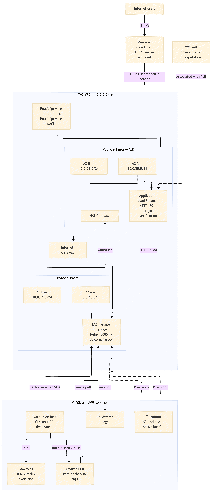. The diagram reflects the actual **CloudFront HTTPS → ALB HTTP → ECS** `Browser --HTTPS--> CloudFront --HTTP + custom origin header--> ALB:80 --HTTP--> ECS:8080`


## Part 1 — Dockerfile and application

| Requirement | Implementation / evidence |
|---|---|
| Nginx reverse proxy | Nginx forwards requests to Uvicorn/FastAPI. |
| Application server | Uvicorn serves the FastAPI application. |
| Slim official base image | Python slim image based on Debian 13; chosen to reduce image size and unnecessary packages. |
| Multi-stage build | Implemented in `Dockerfile`; verify current stages against the submitted source. |
| Non-root execution | Implemented in `Dockerfile`; verify UID, Nginx writable directories and process permissions in source. |
| No baked-in secrets | No AWS credentials should be included in Docker build arguments or image layers. |
| Separate health endpoints | `/health/live` and `/health/ready` return minimal status JSON. |

### Why Debian 13?

The initial CI image scan found **two critical OS-library vulnerabilities**, and the pipeline failed as intended. The base image was updated to a Debian 13 slim variant, and the subsequent scan and ECR push succeeded. This is evidence that the vulnerability gate blocks unsuitable images rather than merely reporting vulnerabilities.

### Application evidence

**Homepage served over HTTPS through CloudFront**

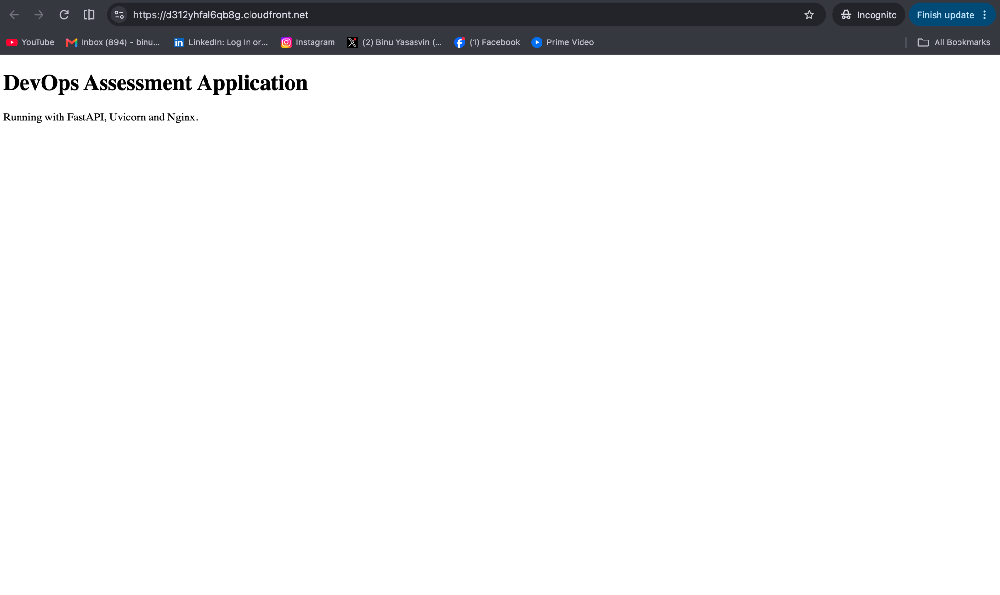

**Liveness endpoint**

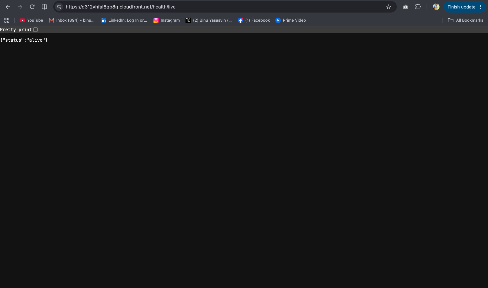

**Readiness endpoint**

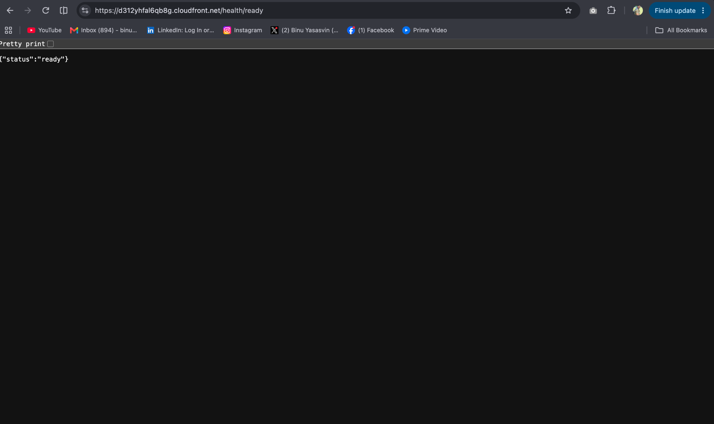

The responses contain no sensitive data. `/health/ready` is also used by the ALB target-group health check, as supported by the application logs below.

## Part 2 — Continuous integration (CI)

The GitHub Actions workflow at `.github/workflows/container-ci.yml`:

1. Checks out the repository.
2. Assumes an AWS IAM role using **GitHub OIDC**, without storing long-lived AWS access keys.
3. Logs into ECR.
4. Builds the container image.
5. Scans the image with **Trivy**, failing the job on **CRITICAL** vulnerabilities.
6. Tags the image using the **full Git commit SHA**.
7. Pushes the image to an **immutable-tag ECR repository**.

### CI validation evidence

**Security gate: failed build because Trivy detected two critical vulnerabilities**

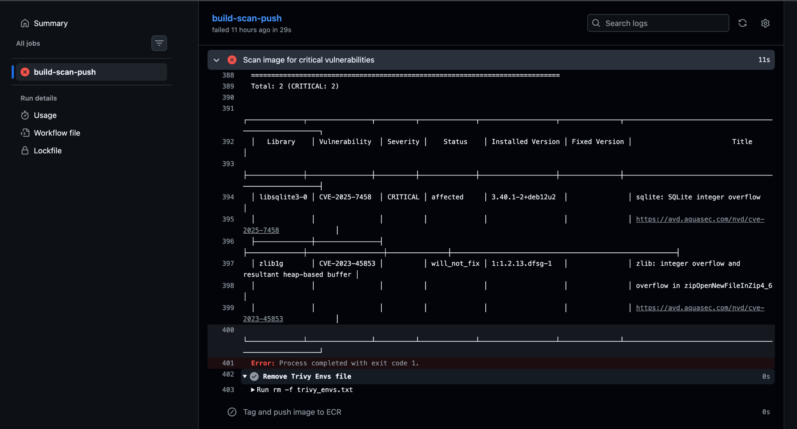

**Security gate and ECR push: successful build after updating the base image**

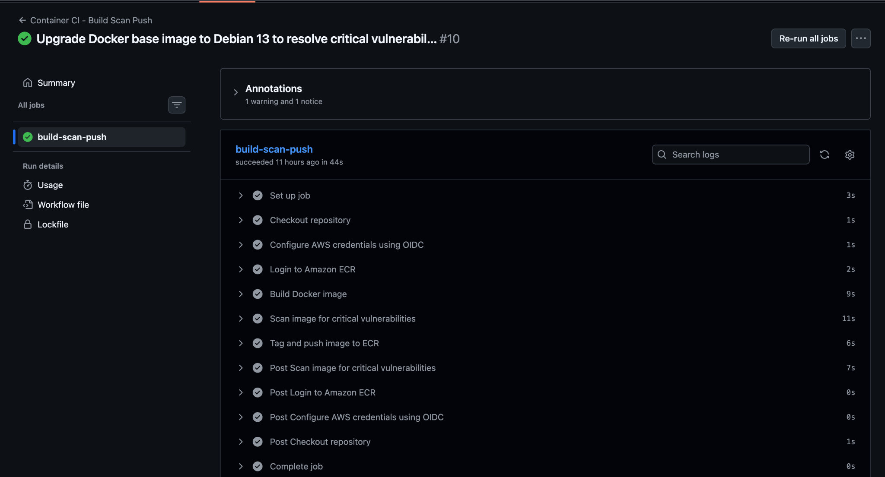

**ECR repository and immutable tag setting**

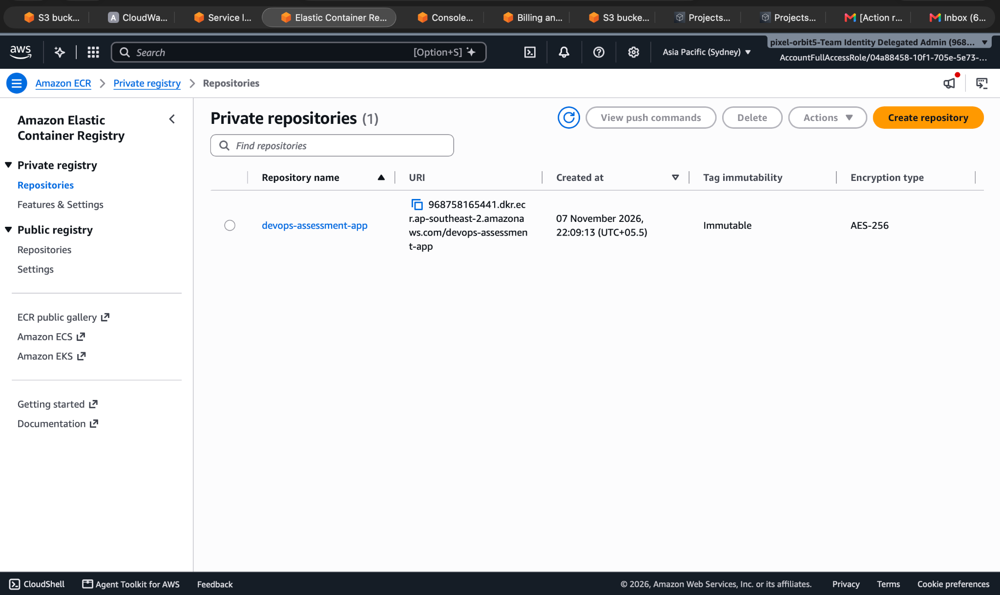

**ECR images tagged with Git commit SHAs**

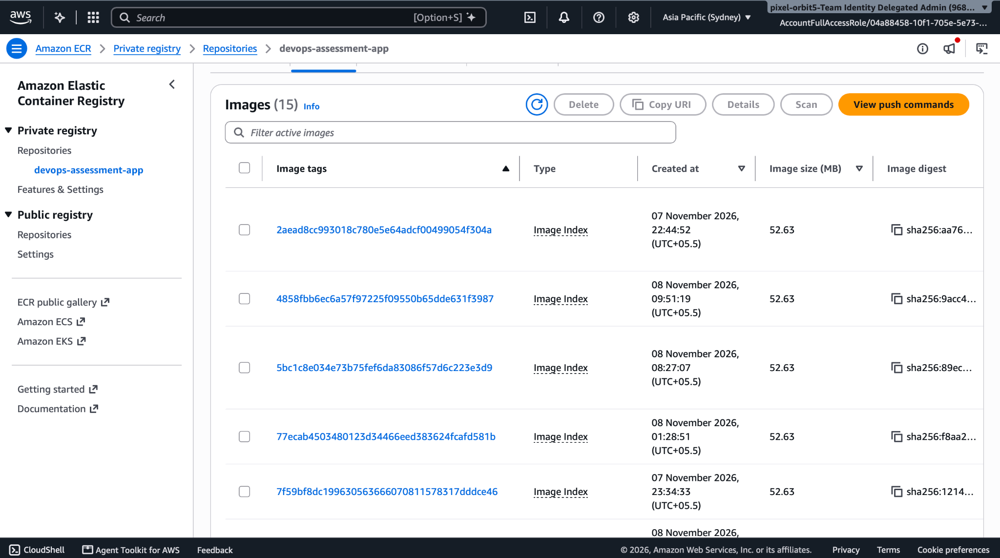

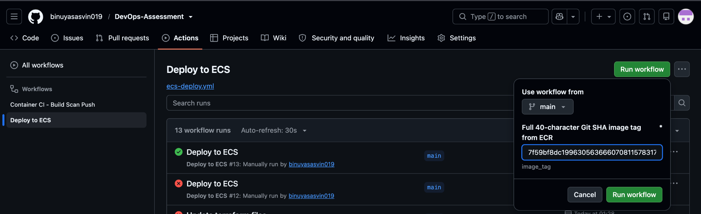

**Security rationale:** OIDC provides temporary role credentials, immutable tags prevent silently replacing an existing image tag, and the critical-severity scan prevents publishing known critically vulnerable builds. An immutable SHA tag should additionally be verified against its ECR **image digest** for artifact promotion.

## Part 3 — Terraform infrastructure

### Network layout

| Resource | Provisioned configuration |
|---|---|
| VPC | `10.0.0.0/16` |
| Private subnet A | `10.0.10.0/24` |
| Private subnet B | `10.0.11.0/24` |
| Public subnet A | `10.0.20.0/24` |
| Public subnet B | `10.0.21.0/24` |
| Route tables | Separate public and private route tables |
| Network ACLs | Separate public and private NACLs |
| Outbound access | Internet Gateway and NAT Gateway |
| Compute | ECS Fargate tasks in private subnets, without public task IPs |
| Ingress | CloudFront → internet-facing ALB → ECS |
| WAF | Regional AWS WAF associated with ALB |
| Logs | ECS `awslogs` driver to CloudWatch Logs |
| IAM | Separate ECS execution and task roles; GitHub Actions OIDC role |
| Terraform state | S3 backend with native lockfile (`use_lockfile = true`) |

**NAT cost trade-off:** NAT Gateway was chosen for straightforward outbound access from private ECS tasks. It incurs hourly and per-GB charges. A more optimized deployment could use appropriate VPC endpoints for ECR, CloudWatch Logs and other AWS services; endpoint hourly/data costs and remaining outbound requirements would need to be compared.

**Fargate trade-off:** Fargate was selected instead of EC2 capacity providers to avoid maintaining container host instances for a small assessment application. This reduces operations overhead but has different per-task pricing and control characteristics.

### Important ALB HTTPS / ACM deviation and why

The assessment specifically asks for:
- ALB port **80** redirecting to **443**;
- an ALB **HTTPS** listener forwarding to ECS;
- an **ACM certificate**.

**That exact configuration was not deployed.** The actual design is:

`Browser --HTTPS--> CloudFront --HTTP + custom origin header--> ALB:80 --HTTP--> ECS:8080`

We initially explored registering a custom domain in Route 53, but registration did not complete. Completing domain registration would have introduced an additional domain-registration cost and DNS/certificate setup for this temporary assessment. To avoid paying for a domain solely for the exercise, we chose the default CloudFront domain, which provides a managed HTTPS viewer endpoint without purchasing a custom domain.

**Consequences and limitations:**
- End users connect to CloudFront over HTTPS.
- **CloudFront-to-ALB traffic is HTTP**, so encryption is **not end-to-end**.
- The ALB has **no ACM certificate / HTTPS listener / HTTP-to-HTTPS redirect**; this is a **partial-compliance deviation**, not an equivalent implementation of the requested ALB requirement.
- ALB inbound access is restricted to the AWS-managed CloudFront origin-facing prefix list, and the listener checks a custom origin-verification header. This reduces unwanted direct-origin access but the header is not a replacement for TLS or a full origin authentication mechanism.
- For strict production compliance, register/use a controlled DNS name, validate an ACM certificate for the ALB, add a port 443 HTTPS listener, configure the port 80 redirect, and set CloudFront origin protocol to HTTPS.

**Why this is documented:** The exercise explicitly values assumptions and cost/security trade-offs. We chose a functioning, externally HTTPS-accessible demonstration over purchasing a domain for a short-lived assessment, while openly documenting the deviation and the steps required to eliminate it.

### WAF, IAM and logging

AWS WAF is configured with `AWSManagedRulesCommonRuleSet` and `AWSManagedRulesAmazonIpReputationList` on the ALB. The ECS task execution role and application task role are separate; GitHub Actions uses an OIDC-assumed IAM role with deployment and ECR permissions.

The container uses CloudWatch Logs; startup and ALB `/health/ready` requests can be observed in the log stream.

**ECS cluster: one active service, one running task**

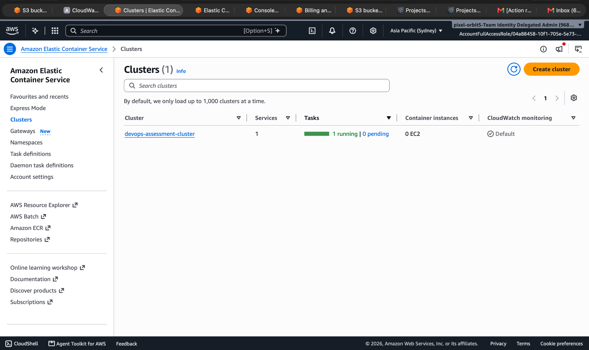

**ECS service: successful deployment and task definition revision**

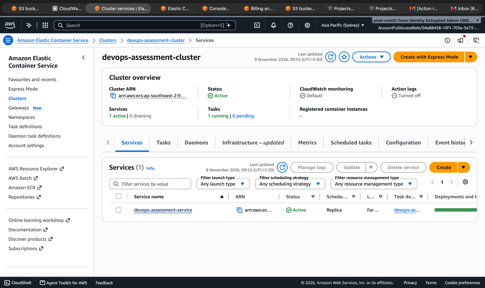

**CloudWatch application and ALB readiness-check logs**

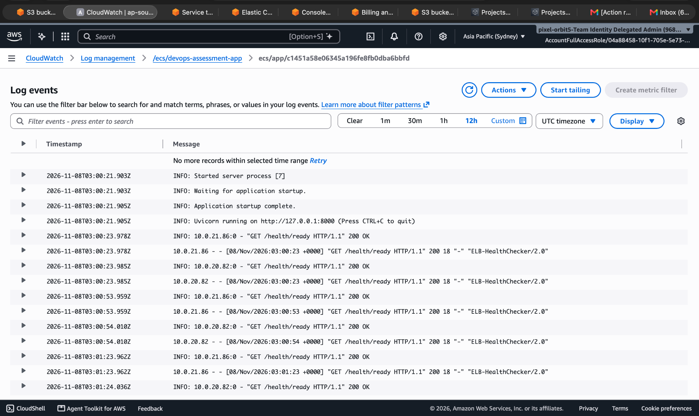

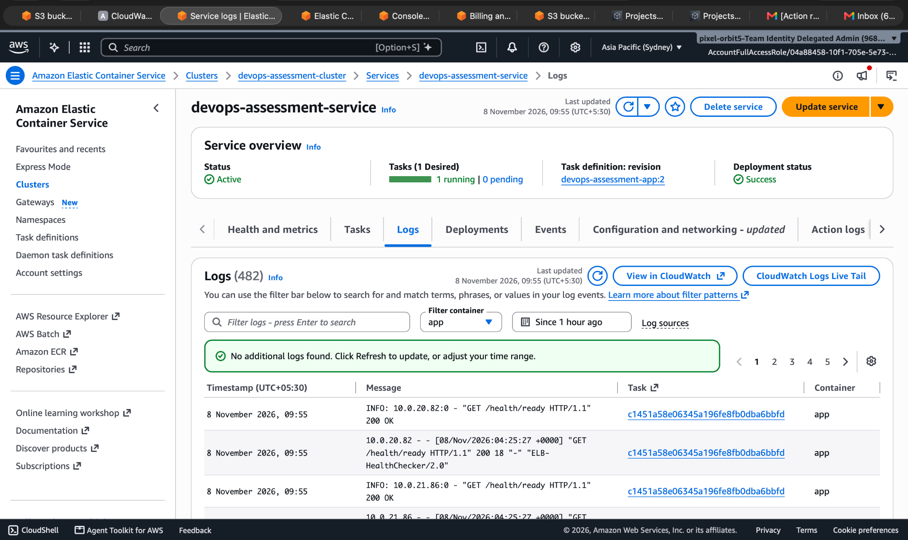

### S3 backend and state locking

The Terraform S3 backend uses:

```hcl
terraform {
  backend "s3" {
    key          = "problem-4-ecs/terraform.tfstate"
    region       = "ap-southeast-2"
    encrypt      = true
    use_lockfile = true
  }
}
```

The **bucket name is supplied at initialization time**, avoiding a hardcoded account ID in the committed Terraform:

```bash
terraform init -reconfigure \
  -backend-config="bucket=<YOUR_EXISTING_STATE_BUCKET>"
terraform validate
terraform plan
```

The S3 bucket must already exist. Native S3 state locking uses a lockfile, so a DynamoDB lock table is not required. Backend authentication should use a supported temporary AWS credential source. **Never commit state files, Terraform plan binaries, `.tfvars` secrets, AWS credentials or account-specific secrets.**

**S3 Terraform state evidence**

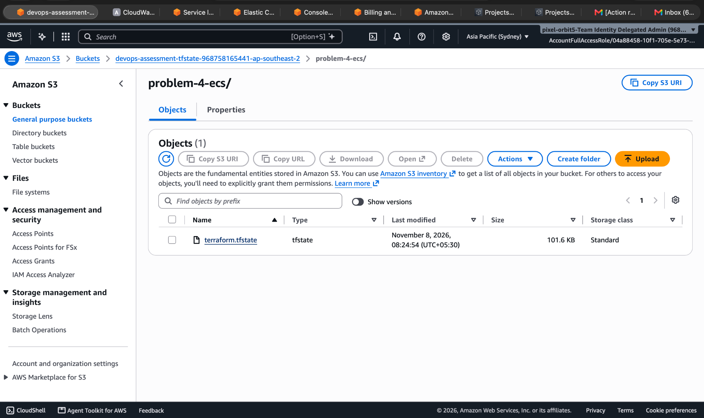

## Part 4 — Infrastructure diagram

See the [. It covers CloudFront, WAF, ALB, VPC, subnets, route tables, NACLs, NAT, ECS, ECR, CloudWatch, IAM, GitHub Actions and the S3 Terraform backend.

## Part 5 — Continuous deployment (CD)

The workflow at `.github/workflows/ecs-deploy.yml` allows manual selection of an **existing full 40-character SHA image tag**.

Deployment steps:

1. Validate the requested tag.
2. Authenticate to AWS using GitHub OIDC.
3. Verify the image exists in ECR.
4. Retrieve the current ECS service task definition.
5. Create and register a new task definition revision using the selected ECR image.
6. Update the ECS service.
7. Wait for ECS service stabilization.
8. Verify the requested task definition is deployed, running count equals desired count, and rollout state is `COMPLETED`.

### Observed successful deployment

A completed GitHub Actions run registered `devops-assessment-app:2` and verified:

- Expected and deployed task definitions matched.
- Running tasks: **1**.
- Desired tasks: **1**.
- Rollout state: **COMPLETED**.

This demonstrates **successful deployment of a selected ECR image**.

### Automatic failure detection and rollback — pending verification

The intended design is the **ECS deployment circuit breaker** with rollback enabled. ECS can mark a failed rolling deployment and restore the last successfully completed deployment. The GitHub Actions service-stability wait and final task-definition comparison should detect that the requested release did not become active.

The repository currently provisions **one ECS service**. A production-ready extension would provision separate **staging** and **production** services, preferably with environment-specific configuration and approval controls:

1. Build, scan and publish **one immutable SHA-tagged image** to ECR.
2. Deploy that exact **image digest** to staging.
3. Run health checks, smoke tests and any integration tests.
4. Obtain production approval through GitHub Environments or a controlled release process.
5. Deploy the **same image digest** to production; **do not rebuild**.
6. Observe deployment health and rely on configured ECS rollback for failed deployments.

## Compliance and remaining work

| Assessment requirement | Status |
|---|---|
| Nginx + Uvicorn/FastAPI | Implemented |
| Slim official image, multi-stage, non-root | Implemented |
| Liveness and readiness endpoints | Verified |
| CI build, critical-vulnerability gate, ECR push | Verified |
| Full Git SHA tags, ECR immutability | Verified |
| OIDC instead of long-lived keys | Verified in successful workflows |
| VPC, subnets, route tables, NACLs, NAT | Provisioned; source-level audit pending |
| ECS Fargate, ALB readiness checks | Verified |
| WAF managed rule groups | Provisioned |
| Separate IAM roles and CloudWatch Logs | Implemented |
| S3 backend with native locking | Implemented |
| **ALB HTTPS, ACM, HTTP redirect** | **Deviation: CloudFront HTTPS instead** |
| Editable infrastructure diagram | Included |
| Selected-image ECS deployment | Verified |
| Automatic rollback | **Verified** |
| Staging → production promotion | **Design documented; Verified** |

## Official documentation and references

- [Amazon ECS on AWS Fargate](https://docs.aws.amazon.com/AmazonECS/latest/developerguide/AWS_Fargate.html)
- [Amazon ECS task definitions](https://docs.aws.amazon.com/AmazonECS/latest/developerguide/task_definitions.html)
- [Amazon ECS container health checks](https://docs.aws.amazon.com/AmazonECS/latest/developerguide/healthcheck.html)
- [Amazon ECS deployment circuit breaker](https://docs.aws.amazon.com/AmazonECS/latest/developerguide/deployment-circuit-breaker.html)
- [Amazon ECS deployment failure detection](https://docs.aws.amazon.com/AmazonECS/latest/developerguide/deployment-failure-detection.html)
- [Amazon ECS deployment state-change events](https://docs.aws.amazon.com/AmazonECS/latest/developerguide/ecs_service_deployment_events.html)
- [Amazon ECR image tag immutability](https://docs.aws.amazon.com/AmazonECR/latest/userguide/image-tag-mutability.html)
- [Amazon ECR image scanning](https://docs.aws.amazon.com/AmazonECR/latest/userguide/image-scanning.html)
- [GitHub OIDC federation with AWS IAM](https://docs.aws.amazon.com/IAM/latest/UserGuide/id_roles_providers_create_oidc.html)
- [ECS CloudWatch Logs (`awslogs`)](https://docs.aws.amazon.com/AmazonECS/latest/developerguide/using_awslogs.html)
- [Amazon VPC NAT gateways](https://docs.aws.amazon.com/vpc/latest/userguide/vpc-nat-gateway.html)
- [CloudFront managed prefix list](https://docs.aws.amazon.com/AmazonCloudFront/latest/DeveloperGuide/LocationsOfEdgeServers.html)
- [CloudFront custom origin HTTPS requirements](https://docs.aws.amazon.com/AmazonCloudFront/latest/DeveloperGuide/using-https-cloudfront-to-custom-origin.html)
- [ALB HTTPS listeners and certificates](https://docs.aws.amazon.com/elasticloadbalancing/latest/application/create-https-listener.html)
- [AWS WAF managed rule groups](https://docs.aws.amazon.com/waf/latest/developerguide/aws-managed-rule-groups-list.html)
- [Terraform S3 backend and native lockfile](https://developer.hashicorp.com/terraform/language/backend/s3)

## Security, assumptions and cleanup

- Do not commit account IDs, secrets, access keys, state or sensitive plan files.
- Replace environment-specific values with Terraform variables and GitHub Actions variables.
- The origin-verification header value must be treated as a secret; it is not included here.
- This is a single-task assessment deployment, not a high-availability production deployment.
- NAT Gateway, ALB, Fargate, WAF and CloudFront may incur charges while running.
- After capturing assessment evidence, destroy the Terraform-managed infrastructure and review remaining non-Terraform resources separately.

## AI assistance disclosure

AI assistance was used to explain AWS and Terraform configuration, troubleshoot IAM/OIDC/ECS/ALB/Cloud-front/Docker application and CI/CD Implementations & errors, structure the infrastructure diagrams and draft documentation.
